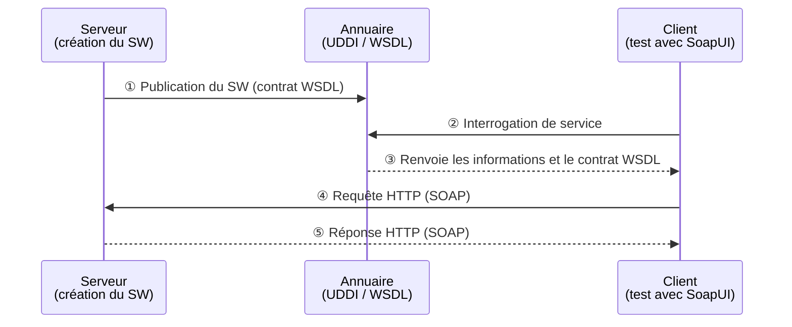

# CalculatriceWS — Service Web SOAP avec Jakarta XML Web Services

> **TP2 : Mise en œuvre de Jakarta XML Web Services**
> Matière : Architecture SOA et services web — Filière : LSI3-GLSI
> Faculté des Sciences de Sfax — Année universitaire 2025-2026
> Réalisé par : **Chayma Bouassida**

Application Java (Maven) qui expose un **service web SOAP** de calculatrice avec quatre opérations : `somme`, `multiplication`, `soustraction` et `division`. Le service est publié avec `Endpoint.publish(...)` puis testé avec **SoapUI**.

---

## Sommaire

1. [Architecture SOAP (schéma du tableau)](#1-architecture-soap-schéma-du-tableau)
2. [Structure du projet](#2-structure-du-projet)
3. [Dépendances Maven](#3-dépendances-maven)
4. [Implémentation](#4-implémentation)
5. [Publication du service et WSDL](#5-publication-du-service-et-wsdl)
6. [Tests avec SoapUI](#6-tests-avec-soapui)
7. [Récapitulatif des résultats](#7-récapitulatif-des-résultats)

---

## 1. Architecture SOAP (schéma du tableau)

Schéma réalisé en cours : il montre le cycle de vie d'un Web Service entre les trois acteurs **Serveur** (producteur), **Annuaire** (UDDI) et **Client** (consommateur, ici SoapUI).


### Le même schéma, redessiné



### Les étapes en tableau

| N° | Étape | Acteurs | Description |
|----|-------|---------|-------------|
| ① | Publication | Serveur → Annuaire | Le serveur publie le Web Service et son contrat **WSDL** |
| ② | Interrogation | Client → Annuaire | Le client cherche le service dans l'annuaire |
| ③ | Découverte | Annuaire → Client | L'annuaire renvoie les informations et le contrat WSDL |
| ④ | Appel | Client → Serveur | Requête HTTP (POST) contenant une enveloppe SOAP |
| ⑤ | Réponse | Serveur → Client | Réponse HTTP contenant l'enveloppe SOAP avec le résultat |

> **Dans ce TP**, l'annuaire UDDI est optionnel : le client (SoapUI) importe directement le WSDL à l'adresse `http://localhost:8085/CalculatriceWS?wsdl`, puis envoie les requêtes (étapes ④ et ⑤).

### Contenu du contrat WSDL

Le WSDL est un fichier XML composé de six éléments :

| Élément | Section | Rôle |
|---------|---------|------|
| `definitions` | — | Élément racine, déclare les espaces de noms |
| `types` | Abstraite | Types de données échangés (XML Schema / XSD) |
| `message` | Abstraite | Messages de requête et de réponse |
| `portType` | Abstraite | Opérations disponibles (entrée / sortie) |
| `binding` | Concrète | Protocole et format (SOAP, style document/literal) |
| `service` | Concrète | Adresse (endpoint) où le service est accessible |

---

## 2. Structure du projet

```
CalculatriceWS
├── pom.xml
├── README.md
└── src
    └── main
        └── java
            ├── serveur
            │   └── ServeurJWS.java      # publie le service (Endpoint.publish)
            └── service
                ├── ICalculatrice.java   # interface = contrat du service
                └── Calculatrice.java    # implémentation = code métier
```

| Package | Classe | Rôle |
|---------|--------|------|
| `service` | `ICalculatrice` | Interface annotée `@WebService` : définit le contrat |
| `service` | `Calculatrice` | Implémente l'interface (logique des 4 opérations) |
| `serveur` | `ServeurJWS` | Publie le service à une URL donnée |

---

## 3. Dépendances Maven

Les dépendances à déclarer dans le `pom.xml` (voir le fichier du projet pour les versions exactes) :

| Dépendance | Rôle |
|------------|------|
| `jakarta.xml.ws-api` | Interfaces JAX-WS, par exemple `Endpoint` |
| `jaxws-rt` | Implémentation de référence : exécute réellement le service |
| `jakarta.jws-api` | Annotations `@WebService`, `@WebMethod`, `@WebParam` |

---

## 4. Implémentation

### 4.1 Interface `ICalculatrice` (le contrat)

Annotations utilisées :

| Annotation | Rôle |
|------------|------|
| `@WebService` | Déclare l'interface comme contrat d'un service SOAP |
| `@WebMethod` | Expose la méthode comme opération du service |
| `@WebParam(name = "a")` | Donne un nom explicite au paramètre dans la requête SOAP |

```java
package service;

import javax.jws.WebMethod;
import javax.jws.WebParam;
import javax.jws.WebService;

@WebService
public interface ICalculatrice {

    @WebMethod
    double somme(@WebParam(name = "a") double a,
                 @WebParam(name = "b") double b);

    @WebMethod
    double multiplication(@WebParam(name = "a") double a,
                          @WebParam(name = "b") double b);

    @WebMethod
    double soustraction(@WebParam(name = "a") double a,
                        @WebParam(name = "b") double b);

    @WebMethod
    double division(@WebParam(name = "a") double a,
                    @WebParam(name = "b") double b);
}
```


### 4.2 Classe `Calculatrice` (l'implémentation)

`endpointInterface` relie l'implémentation à l'interface qui définit le contrat. La division par zéro est refusée par une exception.

```java
package service;

import javax.jws.WebService;

@WebService(endpointInterface = "service.ICalculatrice")
public class Calculatrice implements ICalculatrice {

    @Override
    public double somme(double a, double b) {
        return a + b;
    }

    @Override
    public double multiplication(double a, double b) {
        return a * b;
    }

    @Override
    public double soustraction(double a, double b) {
        return a - b;
    }

    @Override
    public double division(double a, double b) {
        if (b == 0) {
            throw new IllegalArgumentException("Division by zero is not allowed.");
        }
        return a / b;
    }
}
```


### 4.3 Classe `ServeurJWS` (la publication)

```java
package serveur;

import javax.xml.ws.Endpoint;
import service.Calculatrice;

public class ServeurJWS {

    public static void main(String[] args) {

        String url = "http://localhost:8085/CalculatriceWS";

        Endpoint.publish(url, new Calculatrice());

        System.out.println("Service SOAP published successfully!");
        System.out.println("Service URL: " + url);
        System.out.println("WSDL URL: " + url + "?wsdl");
    }
}
```


---

## 5. Publication du service et WSDL

1. Ouvrir le projet dans IntelliJ IDEA.
2. Lancer la méthode `main` de `serveur.ServeurJWS`.
3. Vérifier la console : `Service SOAP published successfully!`
4. Consulter le contrat WSDL dans le navigateur :

| Ressource | URL |
|-----------|-----|
| Service | `http://localhost:8085/CalculatriceWS` |
| WSDL | `http://localhost:8085/CalculatriceWS?wsdl` |

---

## 6. Tests avec SoapUI

**Procédure :**

1. Lancer SoapUI et créer un nouveau projet SOAP.
2. Saisir l'URL du WSDL : `http://localhost:8085/CalculatriceWS?wsdl`.
3. SoapUI affiche les opérations : `somme`, `multiplication`, `soustraction`, `division`.
4. Ouvrir `Request 1` d'une opération, renseigner `a` et `b`, puis lancer la requête (bouton ▶).
5. Lire la réponse XML dans le panneau de droite.

> Le projet `CalculatriceWS` contient la première version (opération `somme` seule), et `CalculatriceWS_V2` contient les quatre opérations.

### 6.1 Opération `somme` (5 + 3)

**Requête**

```xml
<soapenv:Envelope xmlns:soapenv="http://schemas.xmlsoap.org/soap/envelope/"
                  xmlns:ser="http://service/">
   <soapenv:Header/>
   <soapenv:Body>
      <ser:somme>
         <a>5</a>
         <b>3</b>
      </ser:somme>
   </soapenv:Body>
</soapenv:Envelope>
```

**Réponse**

```xml
<S:Envelope xmlns:S="http://schemas.xmlsoap.org/soap/envelope/">
   <S:Body>
      <ns2:sommeResponse xmlns:ns2="http://service/">
         <return>8.0</return>
      </ns2:sommeResponse>
   </S:Body>
</S:Envelope>
```


### 6.2 Opération `multiplication` (5 × 3)

La requête a la même forme, avec `<ser:multiplication>` ; la réponse contient `<return>15.0</return>`.


### 6.3 Opération `soustraction` (5 − 3)

La requête a la même forme, avec `<ser:soustraction>` ; la réponse contient `<return>2.0</return>`.


### 6.4 Opération `division` (6 ÷ 3)

La requête a la même forme, avec `<ser:division>` (`a` = 6, `b` = 3) ; la réponse contient `<return>2.0</return>`.


---

## 7. Récapitulatif des résultats

| Opération | a | b | Résultat attendu | Résultat SoapUI | Temps de réponse | Taille réponse |
|-----------|---|---|------------------|-----------------|------------------|----------------|
| `somme` | 5 | 3 | 8.0 | **8.0** ✅ | 256 ms | 219 octets |
| `multiplication` | 5 | 3 | 15.0 | **15.0** ✅ | 12 ms | 238 octets |
| `soustraction` | 5 | 3 | 2.0 | **2.0** ✅ | 11 ms | 233 octets |
| `division` | 6 | 3 | 2.0 | **2.0** ✅ | 56 ms | 225 octets |

---

## Auteur

**Chayma Bouassida** — Faculté des Sciences de Sfax, LSI3-GLSI
