# CalculatriceWS — Développement d'un Service Web SOAP avec Java

> **TP2 : Mise en œuvre de Jakarta XML Web Services**
> Matière : Architecture SOA et services web — Filière : LSI3-GLSI
> Faculté des Sciences de Sfax — Année universitaire 2026-2027
> Réalisé par : **Chayma Bouassida**

Application Java (Maven) qui expose un **service web SOAP** de calculatrice avec quatre opérations : `somme`, `multiplication`, `soustraction` et `division`. Le service est publié avec `Endpoint.publish(...)`, puis testé avec **SoapUI**.

---

## Sommaire
1. [Présentation du projet](#1-présentation-du-projet)
2. [Architecture d'un service web SOAP](#2-architecture-dun-service-web-soap)
3. [Exemple détaillé : l'opération `somme`](#3-exemple-détaillé--lopération-somme)
4. [Structure d'un message SOAP](#4-structure-dun-message-soap)
5. [Structure du contrat WSDL](#5-structure-du-contrat-wsdl)
6. [Structure du projet et diagramme de classes](#6-structure-du-projet-et-diagramme-de-classes)
7. [Implémentation](#7-implémentation)
8. [Publication du service et WSDL](#8-publication-du-service-et-wsdl)
9. [Tests avec SoapUI](#9-tests-fonctionnels-avec-soapui)
10. [Récapitulatif des résultats](#10-récapitulatif-des-résultats)
11. [Évolution du projet](#11-évolution-du-projet)
12. [Conclusion](#12-conclusion)

---

## 1. Présentation du projet

Ce projet consiste à développer et à publier un service Web SOAP en Java à l'aide de Maven et de l'API JAX-WS.

L'application **CalculatriceWS** expose des opérations mathématiques élémentaires permettant à un client distant d'effectuer des calculs à travers une interface de communication standardisée.

Le service propose quatre opérations :

* `somme` : addition de deux nombres ;
* `multiplication` : multiplication de deux nombres ;
* `soustraction` : soustraction de deux nombres ;
* `division` : division de deux nombres.

Le service est publié à l'aide de la méthode `Endpoint.publish()`. Son contrat est décrit par un fichier WSDL généré automatiquement. Les opérations sont ensuite testées à l'aide de **SoapUI**, qui permet d'envoyer des requêtes SOAP et d'analyser les réponses XML retournées par le serveur.

Ce TP permet ainsi de mettre en pratique les concepts fondamentaux de l'architecture orientée services (SOA) et de la communication entre applications distribuées.

---

## 2. Architecture d'un service web SOAP

Trois acteurs participent à un service web : le **serveur** (producteur), l'**annuaire** UDDI (registre des contrats WSDL) et le **client** (consommateur, ici SoapUI).

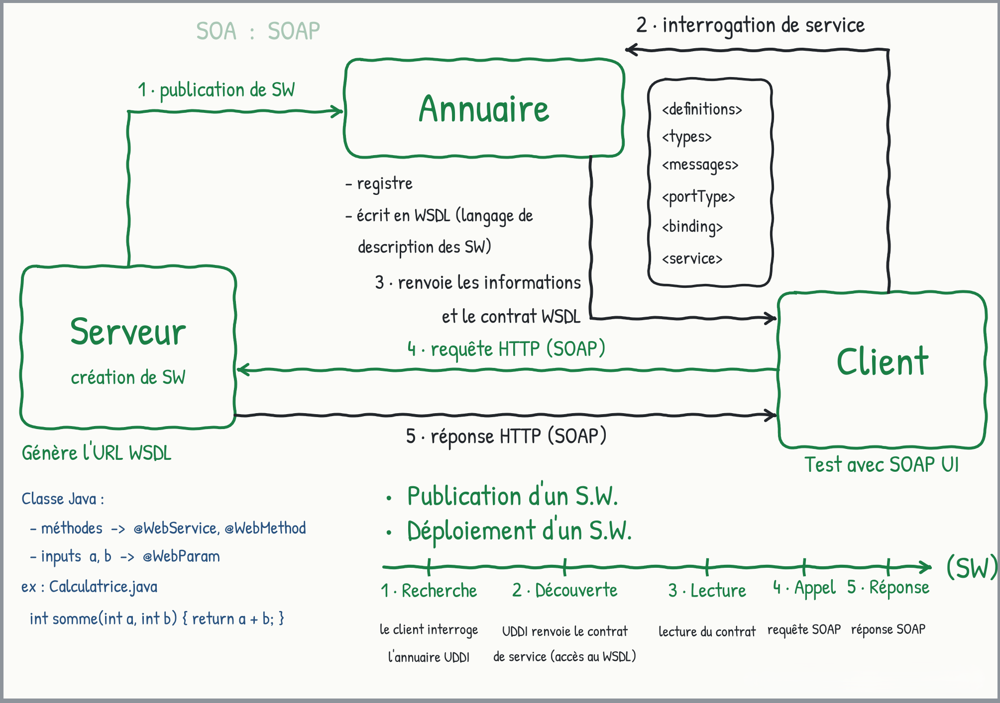


### Description des étapes

| Étape           | Acteurs            | Description                                                                            |
| --------------- | ------------------ | -------------------------------------------------------------------------------------- |
| 1. Publication   | Serveur → Annuaire | Le producteur publie le service Web et son contrat WSDL.                               |
| 2. Interrogation | Client → Annuaire  | Le client recherche un service correspondant à son besoin.                             |
| 3. Découverte    | Annuaire → Client  | L'annuaire retourne les informations permettant d'utiliser le service.                 |
| 4. Invocation    | Client → Serveur   | Le client envoie une requête HTTP contenant une enveloppe SOAP.                        |
| 5. Réponse       | Serveur → Client   | Le serveur retourne une réponse HTTP contenant le résultat sous forme de message SOAP. |


### Cycle de vie du service

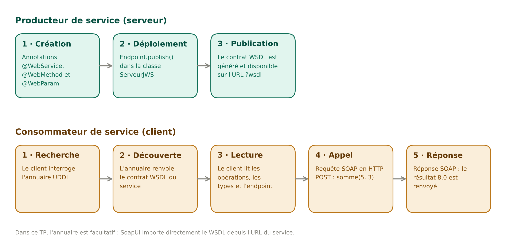

> **Dans ce TP**, l'annuaire UDDI est facultatif : SoapUI importe directement le WSDL depuis `http://localhost:8085/CalculatriceWS?wsdl`, puis envoie les requêtes (étapes 4 et 5).

---

## 3. Exemple détaillé : l'opération `somme`

Le même schéma, avec le code du serveur, le contrat WSDL et les messages SOAP échangés pour `somme(5, 3)`.

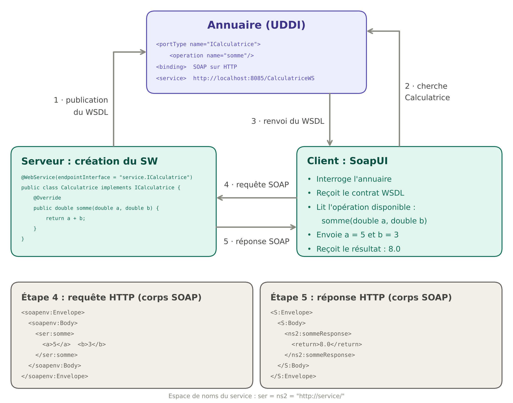

---

## 4. Structure d'un message SOAP

Un appel SOAP est un message XML transporté dans une requête HTTP. Il contient une **enveloppe**, un **en-tête** (optionnel) et un **corps** qui décrit l'appel de méthode et ses données.

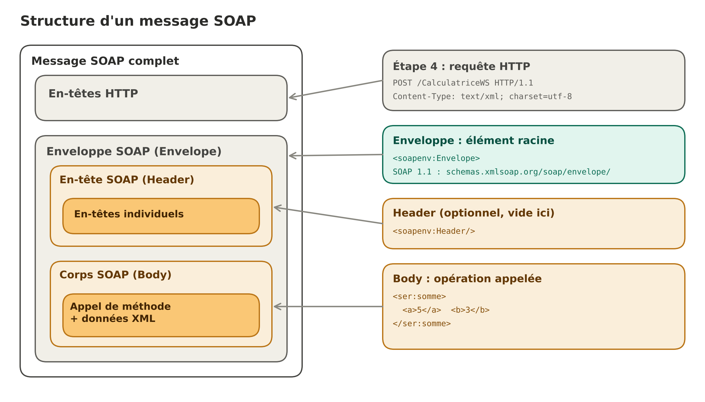

---

## 5. Structure du contrat WSDL

Le WSDL est un fichier XML généré automatiquement lors de la publication. Il se compose d'une partie **abstraite** (ce que fait le service) et d'une partie **concrète** (comment et où y accéder).

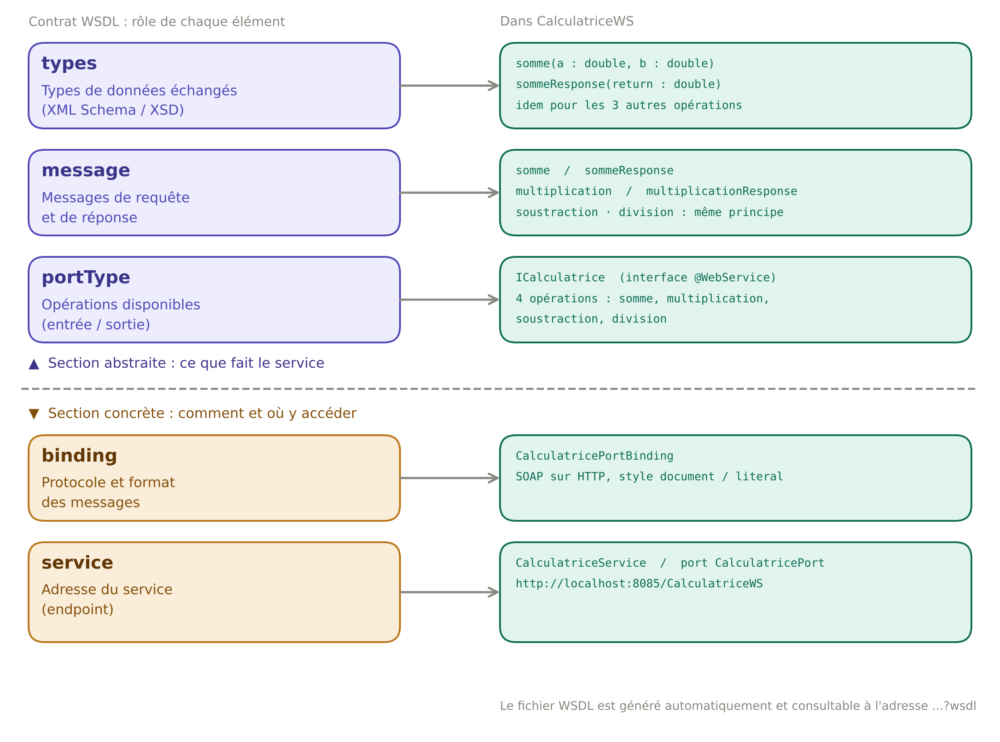

| Élément | Section | Rôle |
|---------|---------|------|
| `definitions` | — | Élément racine, déclare les espaces de noms |
| `types` | Abstraite | Types de données échangés (XML Schema / XSD) |
| `message` | Abstraite | Messages de requête et de réponse |
| `portType` | Abstraite | Opérations disponibles (entrée / sortie) |
| `binding` | Concrète | Protocole et format (SOAP, style document/literal) |
| `service` | Concrète | Adresse (endpoint) où le service est accessible |

---

## 6. Structure du projet et diagramme de classes

Le projet Maven est organisé de manière à séparer le contrat du service, son implémentation et sa publication.

```
CalculatriceWS
├── pom.xml
├── README.md
├── docs
│   └── images                          # schémas et captures d'écran
└── src
    └── main
        └── java
            ├── serveur
            │   └── ServeurJWS.java      # publie le service (Endpoint.publish)
            └── service
                ├── ICalculatrice.java   # interface = contrat du service
                └── Calculatrice.java    # implémentation = code métier
```


### Rôle des composants

| Package   | Classe          | Responsabilité                                                |
| --------- | --------------- | ------------------------------------------------------------- |
| `service` | `ICalculatrice` | Définit le contrat du service Web et les opérations exposées. |
| `service` | `Calculatrice`  | Implémente les opérations mathématiques.                      |
| `serveur` | `ServeurJWS`    | Publie et démarre le service Web.                             |
| —         | `pom.xml`       | Configure le projet Maven et ses dépendances.                 |

Cette organisation permet de distinguer la définition des fonctionnalités, leur implémentation et leur mise à disposition aux clients.

### Relations entre les classes

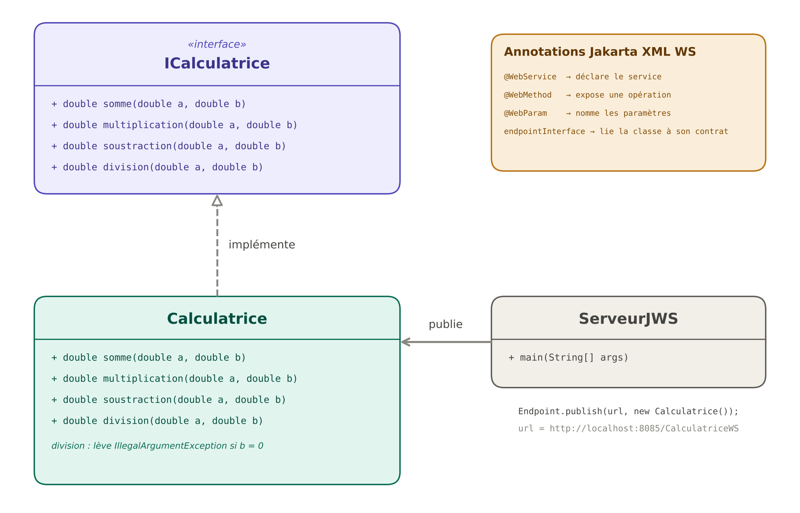


---
### Dépendances Maven

Le projet utilise Maven pour gérer les dépendances nécessaires au développement et à l'exécution du service Web SOAP.

Les principales dépendances sont :

| Dépendance           | Rôle                                                                    |
| -------------------- | ----------------------------------------------------------------------- |
| `jakarta.xml.ws-api` | Fournit les interfaces de l'API des services Web, notamment `Endpoint`. |
| `jaxws-rt`           | Fournit l'implémentation d'exécution du service Web SOAP.               |
| `jakarta.jws-api`    | Fournit les annotations utilisées pour déclarer les services Web.       |

Le fichier `pom.xml` centralise la configuration du projet et facilite la gestion des bibliothèques nécessaires.

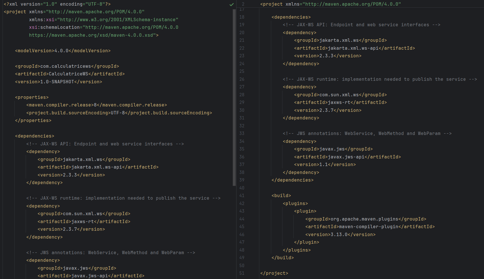


---

## 7. Implémentation

### 7.1 Interface `ICalculatrice` (le contrat)

L'interface `ICalculatrice` définit les opérations accessibles à travers le service Web. Elle représente le contrat fonctionnel entre le client et le serveur.

Les annotations JAX-WS utilisées sont :

| Annotation | Rôle |
|------------|------|
| `@WebService` | Déclare l'interface comme contrat d'un service SOAP |
| `@WebMethod` | Expose la méthode comme opération du service |
| `@WebParam(name = "a")` | Donne un nom explicite au paramètre dans la requête SOAP |

```java
package service;

import javax.jws.WebMethod;
import javax.jws.WebParam;
import javax.jws.WebService;

@WebService
public interface ICalculatrice {

    @WebMethod
    double somme(@WebParam(name = "a") double a,
                 @WebParam(name = "b") double b);

    @WebMethod
    double multiplication(@WebParam(name = "a") double a,
                          @WebParam(name = "b") double b);

    @WebMethod
    double soustraction(@WebParam(name = "a") double a,
                        @WebParam(name = "b") double b);

    @WebMethod
    double division(@WebParam(name = "a") double a,
                    @WebParam(name = "b") double b);
}
```
L'interface définit les signatures des méthodes, sans contenir leur logique de calcul.

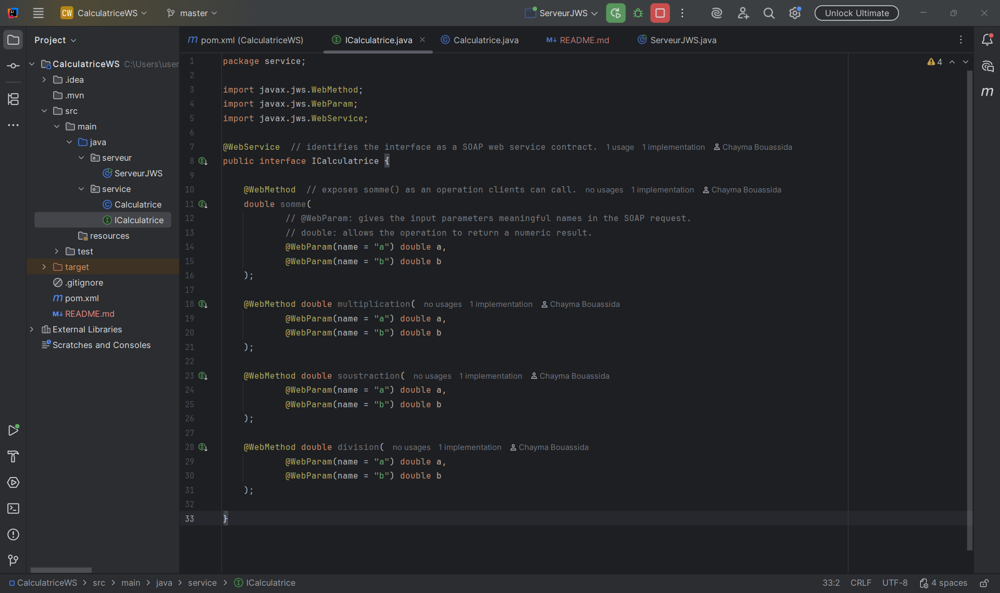

### 7.2 Classe `Calculatrice` : implémentation des opérations

La classe `Calculatrice` implémente l'interface `ICalculatrice`. L'annotation `@WebService(endpointInterface = "service.ICalculatrice")` permet de relier l'implémentation au contrat défini par l'interface.

Chaque méthode réalise une opération mathématique et retourne le résultat correspondant. La division par zéro est traitée par le déclenchement d'une exception.

```java
package service;

import javax.jws.WebService;

@WebService(endpointInterface = "service.ICalculatrice")
public class Calculatrice implements ICalculatrice {

    @Override
    public double somme(double a, double b) {
        return a + b;
    }

    @Override
    public double multiplication(double a, double b) {
        return a * b;
    }

    @Override
    public double soustraction(double a, double b) {
        return a - b;
    }

    @Override
    public double division(double a, double b) {
        if (b == 0) {
            throw new IllegalArgumentException("Division by zero is not allowed.");
        }
        return a / b;
    }
}
```

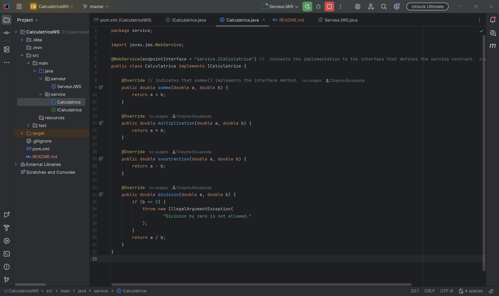

### 7.3 Classe `ServeurJWS` : publication du service

La classe `ServeurJWS` permet de démarrer le service Web et de le rendre accessible à travers une adresse HTTP. La publication est réalisée par la méthode `Endpoint.publish()`.

```java
package serveur;

import javax.xml.ws.Endpoint;
import service.Calculatrice;

public class ServeurJWS {

    public static void main(String[] args) {

        String url = "http://localhost:8085/CalculatriceWS";

        Endpoint.publish(url, new Calculatrice());

        System.out.println("Service SOAP published successfully!");
        System.out.println("Service URL: " + url);
        System.out.println("WSDL URL: " + url + "?wsdl");
    }
}
```

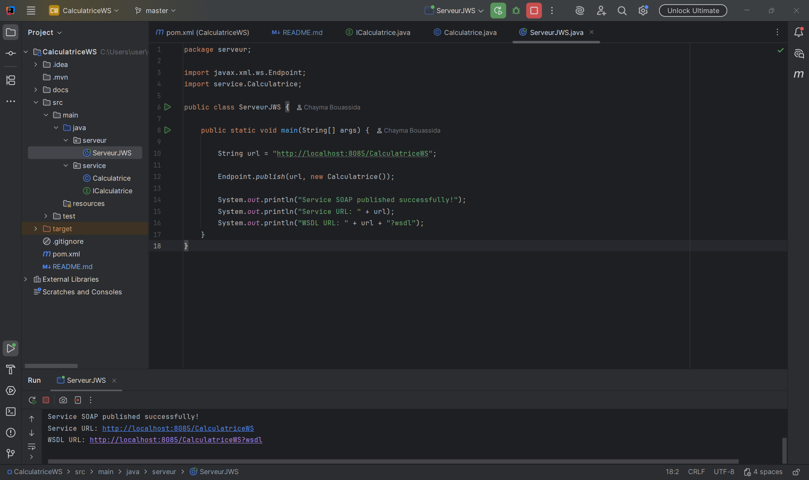

Lors de l'exécution, le service est publié à l'adresse suivante :

```text
http://localhost:8085/CalculatriceWS
```

Le WSDL est accessible à partir de :

```text
http://localhost:8085/CalculatriceWS?wsdl
```

---

## 8. Publication du service et WSDL


### 8.1 Démarrage du service

Pour démarrer le service Web :

1. Ouvrir le projet dans IntelliJ IDEA.
2. Accéder à la classe `ServeurJWS`.
3. Exécuter la méthode `main`.
4. Vérifier les messages affichés dans la console.

La console indique que le service a été publié avec succès et affiche les URL d'accès.

### 8.2 Accès au service

| Ressource     | URL                                         |
| ------------- | ------------------------------------------- |
| Endpoint SOAP | `http://localhost:8085/CalculatriceWS`      |
| Contrat WSDL  | `http://localhost:8085/CalculatriceWS?wsdl` |

### 8.3 Rôle du WSDL

Le WSDL est généré automatiquement par l'environnement JAX-WS (JAX-WS RI 2.3.7). Il décrit les opérations du service, leurs paramètres, les messages SOAP et l'adresse du endpoint.

Le client peut ainsi découvrir les fonctionnalités du service sans avoir accès au code source de la classe `Calculatrice`.

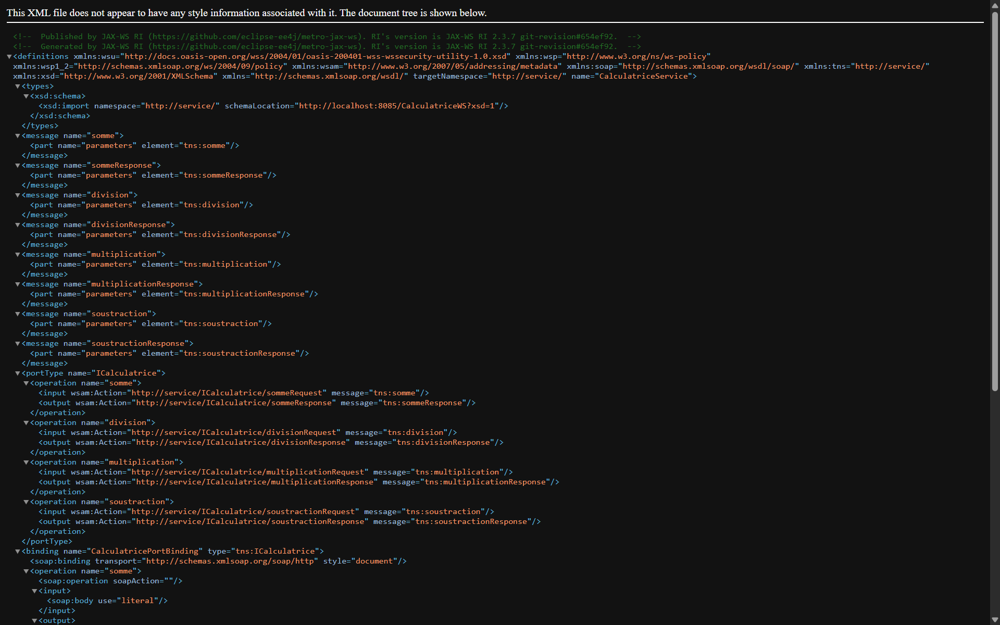

### 8.4 Correspondance entre le code Java et le WSDL

| Dans le code Java                         | Dans le WSDL généré                                              |
| ----------------------------------------- | ---------------------------------------------------------------- |
| package `service`                         | `targetNamespace="http://service/"`                              |
| interface `ICalculatrice`                 | `<portType name="ICalculatrice">`                                |
| méthode `somme(a, b)`                     | `<operation name="somme">` avec les messages `somme` et `sommeResponse` |
| classe `Calculatrice` (`ICalculatrice`)   | `<binding name="CalculatricePortBinding" type="tns:ICalculatrice">` |
| classes d'implémentation du service       | `<definitions ... name="CalculatriceService">`                   |
| types de `a`, `b` et du résultat          | schéma XSD importé : `http://localhost:8085/CalculatriceWS?xsd=1` |

Extrait du WSDL pour l'opération `somme` :

```xml
<message name="somme">
    <part name="parameters" element="tns:somme"/>
</message>
<message name="sommeResponse">
    <part name="parameters" element="tns:sommeResponse"/>
</message>

<portType name="ICalculatrice">
    <operation name="somme">
        <input  wsam:Action="http://service/ICalculatrice/sommeRequest"  message="tns:somme"/>
        <output wsam:Action="http://service/ICalculatrice/sommeResponse" message="tns:sommeResponse"/>
    </operation>
    <!-- division, multiplication, soustraction : même structure -->
</portType>

<binding name="CalculatricePortBinding" type="tns:ICalculatrice">
    <soap:binding transport="http://schemas.xmlsoap.org/soap/http" style="document"/>
    ...
</binding>
```

---

## 9. Tests fonctionnels avec SoapUI

### 9.1 Configuration du projet SoapUI

Les tests fonctionnels sont réalisés à l'aide de SoapUI. La procédure consiste à :

1. Lancer le serveur `ServeurJWS`.
2. Ouvrir SoapUI.
3. Créer un nouveau projet SOAP.
4. Importer le WSDL :

```text
http://localhost:8085/CalculatriceWS?wsdl
```

5. Sélectionner l'opération à tester.
6. Renseigner les paramètres `a` et `b`.
7. Envoyer la requête.
8. Analyser la réponse XML retournée.

SoapUI génère automatiquement la structure des requêtes SOAP à partir du contrat WSDL.

### 9.2 Test de l'opération `somme`

**Paramètres :** `a = 5`, `b = 3` — **Résultat attendu :** `8.0`

#### Requête SOAP

```xml
<soapenv:Envelope
    xmlns:soapenv="http://schemas.xmlsoap.org/soap/envelope/"
    xmlns:ser="http://service/">

    <soapenv:Header/>

    <soapenv:Body>
        <ser:somme>
            <a>5</a>
            <b>3</b>
        </ser:somme>
    </soapenv:Body>

</soapenv:Envelope>
```

#### Réponse SOAP

```xml
<S:Envelope xmlns:S="http://schemas.xmlsoap.org/soap/envelope/">
    <S:Body>
        <ns2:sommeResponse xmlns:ns2="http://service/">
            <return>8.0</return>
        </ns2:sommeResponse>
    </S:Body>
</S:Envelope>
```

La réponse contient le résultat de l'addition dans l'élément `return`.

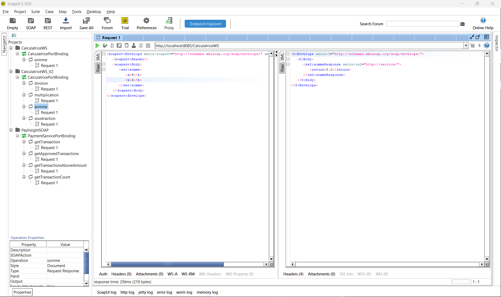

### 9.3 Test de l'opération `multiplication`

**Paramètres :** `a = 5`, `b = 3` — **Résultat attendu :** `15.0`

La requête SOAP utilise l'opération `multiplication`. La réponse contient le résultat du calcul dans l'élément `return`.

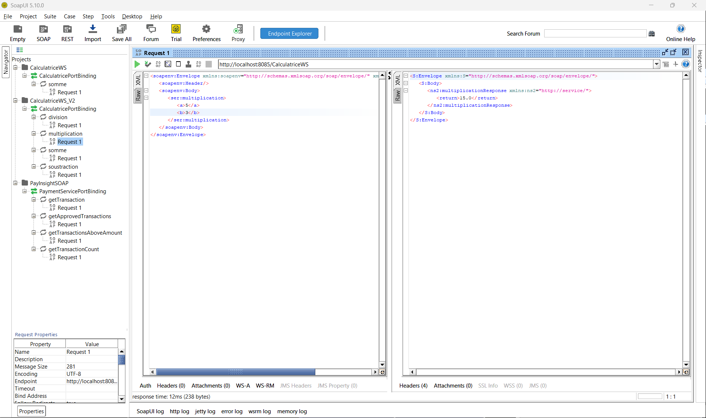

### 9.4 Test de l'opération `soustraction`

**Paramètres :** `a = 5`, `b = 3` — **Résultat attendu :** `2.0`

La requête SOAP utilise l'opération `soustraction`. Le service calcule la différence entre les deux paramètres et retourne le résultat.

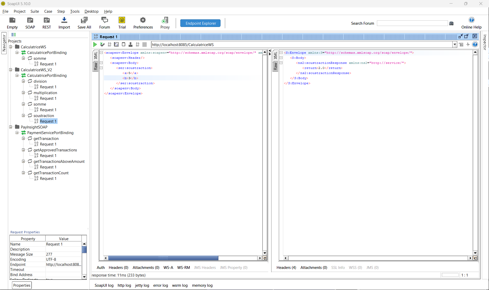

### 9.5 Test de l'opération `division`

**Paramètres :** `a = 6`, `b = 3` — **Résultat attendu :** `2.0`

La requête SOAP utilise l'opération `division`. Le service retourne le quotient des deux paramètres.

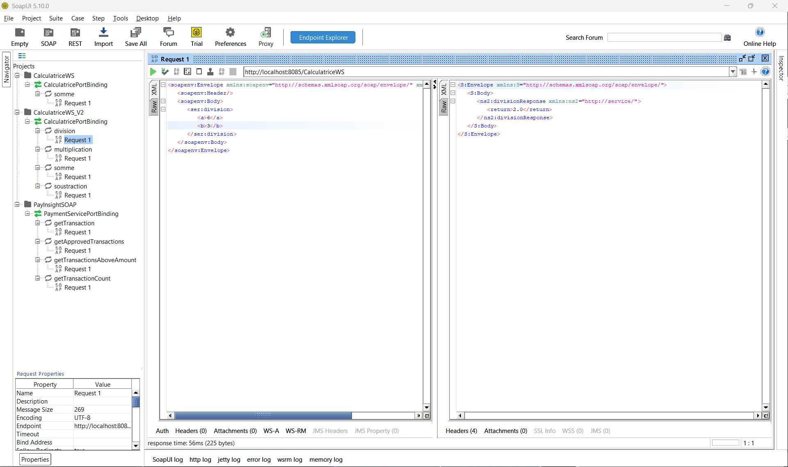

---

## 10. Récapitulatif des résultats

Les tests réalisés avec SoapUI permettent de vérifier le bon fonctionnement des quatre opérations exposées par le service Web.

| Opération        | Paramètre `a` | Paramètre `b` | Résultat attendu | Résultat obtenu | Temps de réponse | Taille de la réponse |
| ---------------- | ------------: | ------------: | ---------------: | --------------: | ---------------: | -------------------: |
| `somme`          |             5 |             3 |              8.0 |       **8.0** ✅ |           256 ms |           219 octets |
| `multiplication` |             5 |             3 |             15.0 |      **15.0** ✅ |            12 ms |           238 octets |
| `soustraction`   |             5 |             3 |              2.0 |       **2.0** ✅ |            11 ms |           233 octets |
| `division`       |             6 |             3 |              2.0 |       **2.0** ✅ |            56 ms |           225 octets |

Les résultats obtenus correspondent aux résultats attendus pour les quatre opérations testées. Les temps de réponse et les tailles des réponses sont ceux relevés lors des tests SoapUI ; ils peuvent varier selon l'environnement d'exécution.

---

## 11. Évolution du projet

Le projet a été développé en deux versions :

| Version             | Fonctionnalités                                                                                    |
| ------------------- | -------------------------------------------------------------------------------------------------- |
| `CalculatriceWS`    | Première version contenant uniquement l'opération `somme`.                                         |
| `CalculatriceWS_V2` | Version étendue contenant les quatre opérations : somme, multiplication, soustraction et division. |

Cette évolution permet d'illustrer l'enrichissement progressif d'un service Web à partir d'une première fonctionnalité, jusqu'à une interface proposant plusieurs opérations.

---

## 12. Conclusion

Ce TP a permis de mettre en pratique les concepts fondamentaux du développement des services Web SOAP avec Java.

La réalisation du projet CalculatriceWS a permis de comprendre les différentes étapes de création d'un service Web : définition du contrat, implémentation des opérations, publication du service, génération du WSDL et tests fonctionnels avec SoapUI.

L'utilisation de JAX-WS a facilité l'exposition des méthodes Java sous forme d'opérations SOAP accessibles à distance. Le WSDL a permis de décrire le contrat du service, tandis que SoapUI a été utilisé pour envoyer des requêtes XML et vérifier les réponses obtenues.

Les tests réalisés ont confirmé le bon fonctionnement des quatre opérations mathématiques dans les cas testés.

Ce travail constitue une introduction pratique aux architectures orientées services (SOA), aux services Web SOAP et à la communication entre applications distribuées.

---

## Auteur

**Chayma Bouassida**
LSI3-GLSI — Faculté des Sciences de Sfax
Année universitaire 2026-2027
